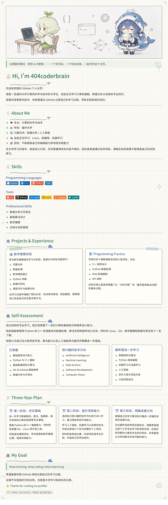

  

📄 文字版（可选中 / 可搜索 / 活徽章）

> 头图里的两位：芽芽 & 大肥鱼 —— 一个写代码，一个吃白米饭，一起守护这个主页。

#  Hi, I'm coderbrain404

欢迎来到我的 GitHub 个人主页！

我是一名福州大学计算机科学与技术的大学生，目前正在学习计算机编程、数据分析以及相关专业知识。

我喜欢探索新的技术，也希望通过 GitHub 记录自己的学习过程、项目实践和成长经历。

##  About Me

* 🎓 专业：计算机科学与技术
* 🏫 学校：福州大学
* 💻 兴趣方向：数据分析 / 人工智能
* 📚 当前正在学习：Linux、数据库、机器学习
* 🎯 目标：不断提高自己的编程能力和项目实践能力

在大学学习过程中，我逐渐认识到，仅仅掌握课本知识是不够的，因此我希望通过实际项目、课程实验和竞赛不断提高自己的实践能力。

##  Skills

### Programming Languages

### Tools

### Professional Skills

* 数据分析与可视化
* 基础算法设计
* 数学建模
* 文档与项目管理

##  Projects & Experience

### 📊 数学建模实践

参与数学建模相关学习与实践，能够针对实际问题进行：

* 问题分析
* 数据处理
* 数学模型建立
* Python 求解
* 数据可视化
* 模型评价与结果分析

在学习过程中接触了回归分析、时间序列预测、规划模型、聚类模型以及启发式优化算法等方法。

### 💻 Programming Practice

完成过多个编程课程实验和小型项目，涉及：

* C++ 程序设计
* Python 数据处理
* Web 前端基础
* API 调用

这些实践让我逐渐掌握了从“分析问题”到“编写程序解决问题”的基本过程。

##  Self Assessment

经过目前的专业学习，我已经掌握了一定的计算机基础知识和程序设计能力。

目前我能够使用 Python 和 C++ 完成基本的数据处理、算法实现和程序设计任务，同时对 Linux、Git、数学建模和数据可视化有了一定了解。

但我认为自己在大型项目开发、算法能力以及人工智能等方面仍然需要进一步提高。

### 已掌握

* 基础程序设计能力
* Python 与 C++ 基础
* 基础数据结构与算法
* Git 与 GitHub 基础使用
* 数据分析与可视化

### 感兴趣的技术方向

* Artificial Intelligence
* Machine Learning
* Data Science
* Software Development
* Computer Vision

### 最希望进一步学习

* 数据结构与算法
* Python 高级编程
* 机器学习与深度学习
* 人工智能
* 软件工程与项目开发
* 大型项目协作

##  Three-Year Plan

### 📅 第一阶段：夯实基础

进一步学习数据结构、算法、数据库、操作系统和计算机网络等专业课程。

提高 Python 和 C++ 编程能力，同时熟练掌握 Git、Linux 等开发工具。

积极参加课程项目、学科竞赛和数学建模比赛，提高实践能力。

### 📅 第二阶段：提升项目能力

选择自己感兴趣的技术方向进行深入学习，重点提高项目开发能力。

学习人工智能、机器学习以及相关技术，并尝试完成几个较为完整的个人项目。

同时积极参加比赛、科研项目或专业实践，丰富自己的项目经历。

### 📅 第三阶段：明确发展方向

根据自己的学习情况和兴趣进一步确定未来的发展方向。

无论最终选择考研还是就业，我都希望通过接下三年专业学习和项目实践，形成比较完整的计算机专业知识体系，并具备独立分析和解决实际问题的能力。

##  My Goal

> Keep learning, keep coding, keep improving.

希望能够利用 GitHub 持续记录自己的学习过程。

这里不仅是我的代码仓库，也是我大学学习和成长的记录。

⭐ Thanks for visiting my profile!

<!-- // stay curious, keep growing. -->

